# Livrable — Refactorisation de FestiPlan

## 1. Exploration de l'application existante

### 1.1 Endpoints exposés (Swagger)

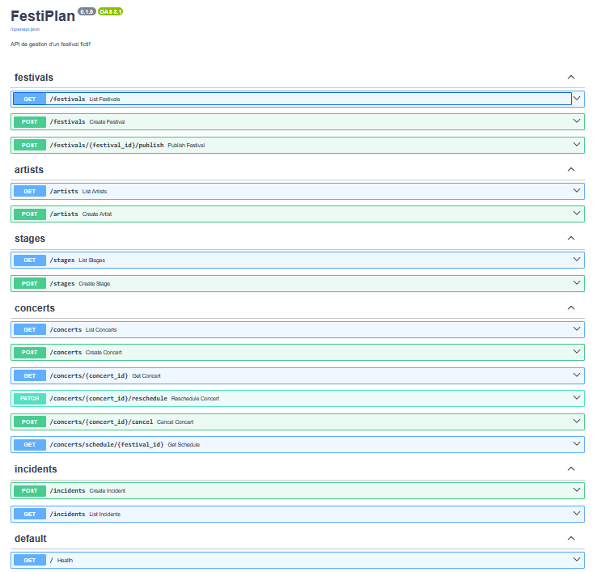

| Groupe | Méthode | Route | Rôle |
|---|---|---|---|
| festivals | GET | `/festivals` | Lister les festivals |
| festivals | POST | `/festivals` | Créer un festival |
| festivals | POST | `/festivals/{festival_id}/publish` | Publier le planning |
| artists | GET / POST | `/artists` | Lister / créer un artiste |
| stages | GET / POST | `/stages` | Lister / créer une scène |
| concerts | GET | `/concerts` | Lister les concerts d'un festival |
| concerts | POST | `/concerts` | Programmer un concert |
| concerts | GET | `/concerts/{concert_id}` | Consulter un concert |
| concerts | PATCH | `/concerts/{concert_id}/reschedule` | Déplacer un concert |
| concerts | POST | `/concerts/{concert_id}/cancel` | Annuler un concert |
| concerts | GET | `/concerts/schedule/{festival_id}` | Planning chronologique |
| incidents | GET / POST | `/incidents` | Lister / déclarer un incident |
| default | GET | `/` | Health check |

### 1.2 Données de démonstration (seed)
Festival « Hellforge Open Air » (id 1, 18 au 20 juin 2027), 4 scènes (Mainstage, Warzone, Valley, Temple), 12 artistes, 14 concerts.

## 2. Défauts reproduits

Les trois défauts ont été reproduits sur le code initial, avec Swagger, avant toute modification. Chaque scénario donne les étapes, le résultat attendu, le résultat observé et la cause dans le code.

### Défaut 1 — Chevauchement de concerts

#### 1a. Même scène (règle R2)

**Étapes**
1. `python -m app.seed`
2. `GET /concerts/schedule/1` : le concert 1 (Iron Vow, Mainstage, 18:00–19:00) et le concert 2 (Crimson Engine, Mainstage, 19:30–20:30) sont distincts.
3. `PATCH /concerts/2/reschedule` avec `{"start_time": "2027-06-18T18:30:00", "end_time": "2027-06-18T19:30:00"}`
4. `GET /concerts/schedule/1` à nouveau.

**Attendu :** refus (400), car la scène est déjà occupée par le concert 1.
**Observé :** `200`, le déplacement est accepté et enregistré. Les concerts 1 et 2 se chevauchent sur Mainstage.

Avant :

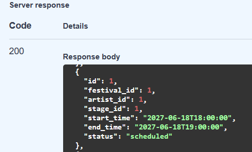
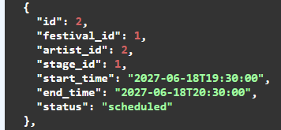

Réponse du déplacement (200) :

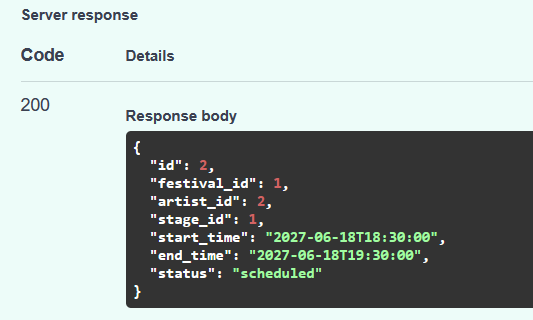

Planning après le déplacement (concerts 1 et 2 sur la scène 1, 18:00–19:00 et 18:30–19:30) :

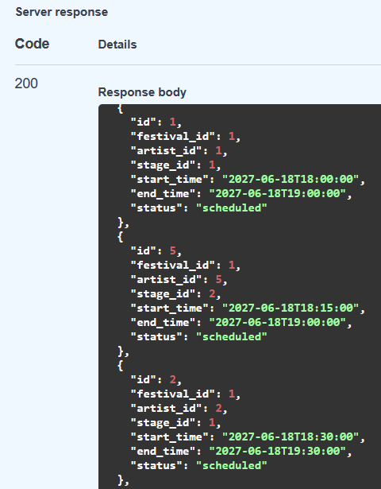

**Cause (code) :** `SchedulingService.reschedule_concert` ne vérifie que `fin > début`. `_check_conflicts` n'est appelée que par `create_concert`.

#### 1b. Même artiste sur deux scènes (règle R3)

**Étapes**
1. `python -m app.seed`
2. `POST /concerts` : Concrete Reign (artiste 4) sur Valley (scène 3), 21:30–22:30. Réponse `201`, concert 15 créé. Le même artiste joue déjà le concert 4 sur Warzone (scène 2), 17:00–17:45.
3. `PATCH /concerts/15/reschedule` avec `{"start_time":"2027-06-18T17:15:00","end_time":"2027-06-18T17:30:00"}` (Valley est libre à ce moment-là, seul l'artiste est en conflit).
4. `GET /concerts/schedule/1`.

**Attendu :** refus (400), l'artiste joue déjà sur Warzone de 17:00 à 17:45.
**Observé :** `200`. Le concert 15 est déplacé et l'artiste 4 est programmé en même temps sur deux scènes.

Création du concert 15 (201) :

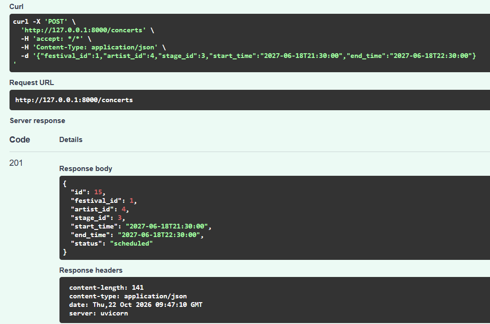

Déplacement accepté (200) :

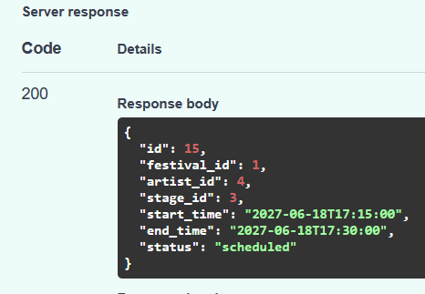

Planning après : concert 4 (scène 2, 17:00–17:45) et concert 15 (scène 3, 17:15–17:30), même `artist_id` 4 :

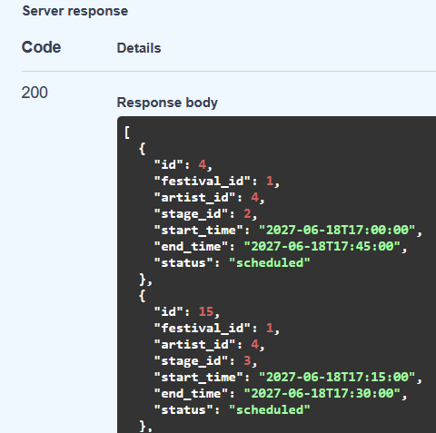

**Cause (code) :** même cause que 1a. `reschedule_concert` n'appelle pas `_check_conflicts`, qui contient pourtant le test d'artiste. Le contrôle existe seulement à la création.

### Défaut 2 — Échec de notification après modification

**Étapes**
1. `python -m app.seed`
2. Relancer uvicorn avec `$env:FESTIPLAN_FAIL_NOTIFICATIONS="true"`.
3. `PATCH /concerts/4/reschedule` avec `{"start_time":"2027-06-18T16:00:00","end_time":"2027-06-18T16:45:00"}`.
4. `GET /concerts/4`.

**Attendu :** la réussite de la modification métier est distinguée de l'échec de la notification. Une réponse 500 ne doit pas laisser croire que rien n'a été modifié.
**Observé :** `500` avec « Simulation : le service de notification est indisponible », alors que le concert est bel et bien déplacé en base.

Réponse du déplacement (500) :

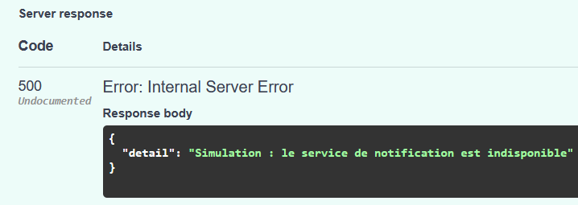

Le concert 4 est pourtant modifié (16:00–16:45) :

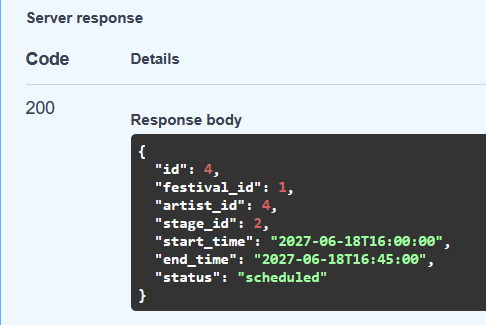

**Cause (code) :** `reschedule_concert` fait `commit()` puis appelle `NotificationService.notify_schedule_change`, qui lève une `RuntimeError`. Le contrôleur la transforme en HTTP 500. La notification est un effet secondaire, mais elle est traitée comme une partie de l'opération métier. Le même schéma existe dans `PublicationService.publish`.

### Défaut 3 — Modification d'un planning publié (règle R7)

**Étapes**
1. `python -m app.seed`
2. `GET /festivals` : le festival 1 est en `preparation`.
3. `POST /festivals/1/publish` : le festival passe à `published`.
4. `PATCH /concerts/4/reschedule` avec `{"start_time":"2027-06-18T16:00:00","end_time":"2027-06-18T16:45:00"}` (créneau valide, Warzone est libre).
5. `GET /concerts/4`.

**Attendu :** refus, le planning est publié et ne doit pas être modifiable par une opération ordinaire.
**Observé :** `200`. Le concert est déplacé et la modification est enregistrée alors que le festival est publié.

Festival avant publication :

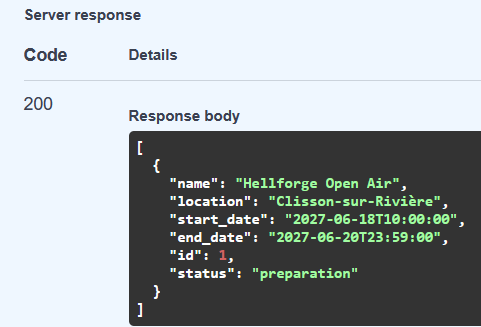

Après publication :

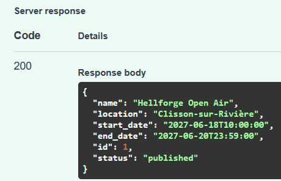

Déplacement accepté (200) :

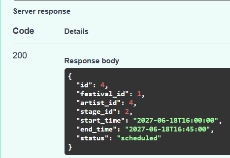

Le concert 4 est bien modifié en base :

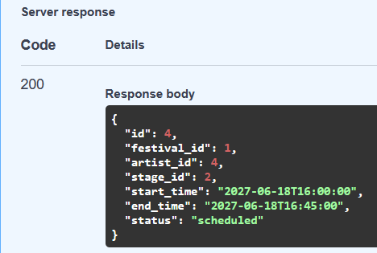

**Cause (code) :** `Festival.status` est une chaîne libre (`"preparation"` / `"published"`) et `reschedule_concert` ne la consulte jamais. Aucune transition d'état n'est modélisée. `cancel_concert` est exposé au même problème.

## 3. Tests de non-régression (écrits avant la correction)

Fichier : `tests/test_regression.py`. Chaque test crée son jeu de données via l'API (festival, 2 scènes, 2 artistes, 3 concerts) puis rejoue un scénario.

| Test | Défaut | Règle | Attendu |
|---|---|---|---|
| `test_reschedule_overlapping_same_stage_is_rejected` | 1a | R2 | 400, concert inchangé |
| `test_reschedule_same_artist_on_two_stages_is_rejected` | 1b | R3 | 400, concert inchangé |
| `test_reschedule_to_free_slot_is_accepted` | 1 | — | 200 (garde-fou) |
| `test_reschedule_succeeds_even_if_notification_fails` | 2 | — | 200 et modification persistée |
| `test_reschedule_after_publication_is_rejected` | 3 | R7 | 400 ou 409, concert inchangé |

### Résultat sur le code legacy (avant refactorisation)

`pytest tests/test_regression.py -v` : **4 failed, 1 passed**.

- les 3 tests de conflits et de planning publié échouent avec `200` au lieu de `400/409` ;
- le test de notification échoue avec `500` au lieu de `200` ;
- le test du déplacement valide passe : il vérifie que la correction ne bloquera pas un cas légitime.

### Résultat après refactorisation

`pytest tests/test_regression.py -v` : **5 passed**. Les 4 tests qui échouaient sur le legacy passent, et le test du déplacement valide reste vert.

Suite complète (`pytest -q`) : **142 passed**.

| Niveau | Dossier | Tests | Ce qui est vérifié | Dépendances techniques |
|---|---|---|---|---|
| Domaine | `tests/domain/` | 54 | Objets-valeurs, entités, transitions publié/préparation, `SchedulingPolicy`, `Incident` | aucune |
| Cas d'usage | `tests/application/` | 43 | Programmer, déplacer, annuler, publier, dépublier, incidents, création, requêtes, avec repositories en mémoire et notifier factice (dont un qui échoue) | aucune |
| Adaptateurs | `tests/adapters/` | 14 | Repositories SQLAlchemy sur SQLite en mémoire, adaptateur de notification | SQLAlchemy |
| API / intégration | `tests/test_api_endpoints.py` et tests historiques | 26 | Routes HTTP, codes de retour, persistance de bout en bout | FastAPI, SQLite |
| Non-régression | `tests/test_regression.py` | 5 | Les 3 défauts initiaux | FastAPI, SQLite |

### Rejeu des scénarios sur le code corrigé

Les scénarios de la section 2 ont été rejoués, avec les mêmes données (`python -m app.seed`) et les mêmes requêtes, sur l'application refactorisée.

| Défaut | Requête | Avant | Après |
|---|---|---|---|
| 1a (R2) | `PATCH /concerts/2/reschedule` 18:30–19:30 | `200`, chevauchement enregistré | `400` « Conflit : la scène est déjà occupée », concert 2 inchangé (19:30–20:30) |
| 1b (R3) | `PATCH /concerts/15/reschedule` 17:15–17:30 | `200`, artiste sur deux scènes | `400` « Conflit : l'artiste est déjà programmé », concert 15 inchangé (21:30–22:30) |
| 2 | `PATCH /concerts/4/reschedule` 16:00–16:45, `FESTIPLAN_FAIL_NOTIFICATIONS=true` | `500`, alors que la modification est enregistrée | `200`, concert 4 à 16:00–16:45, l'échec de notification est journalisé |
| 3 (R7) | `POST /festivals/1/publish` puis `PATCH /concerts/4/reschedule` 16:00–16:45 | `200`, planning publié modifié | `409` « Le planning est publié : dépubliez-le avant de le modifier », concert 4 inchangé (17:00–17:45) |
| 3 (suite) | `POST /festivals/1/unpublish` puis le même `PATCH` | — | `200`, modification acceptée |

Réponse du défaut 2 (notification en panne) :

```json
HTTP 200
{"id": 4, "festival_id": 1, "artist_id": 4, "stage_id": 2,
 "start_time": "2027-06-18T16:00:00", "end_time": "2027-06-18T16:45:00", "status": "scheduled"}
```

Journal serveur au même moment (l'erreur est tracée, pas propagée) :

```
Échec de la notification pour l'événement ConcertRescheduled(concert_id=4, ...)
RuntimeError: Simulation : le service de notification est indisponible
```

Réponse du défaut 3 (planning publié) :

```json
HTTP 409
{"detail": "Le planning est publié : dépubliez-le avant de le modifier"}
```

## 4. Diagnostic de l'architecture initiale

### 4.1 Responsabilités actuelles

| Partie | Fichiers | Ce qu'elle fait réellement |
|---|---|---|
| Démarrage | `main.py`, `config.py`, `database.py` | Crée l'app FastAPI, les tables (`create_all`), l'engine et la session SQLAlchemy globale, lit la config |
| Routes HTTP | `api/*.py` | Reçoivent les requêtes, mais font aussi de l'accès base (`concerts.py`, `incidents.py`), des validations métier et la conversion CSV ↔ liste (`artists.py`, `stages.py`) |
| Services | `services/*.py` | Mélangent règles métier, accès base (`db.query`), `commit` et appel des notifications |
| Repositories | `repositories/*.py` | CRUD SQLAlchemy très fin, qui `commit` à chaque `create`. Les services les contournent souvent avec `self.db.query` |
| Modèles | `models.py` | Tables SQLAlchemy sans comportement : `status` en chaîne libre, équipements stockés en CSV dans un `Text` |
| Schémas | `schemas.py` | Validation Pydantic des requêtes HTTP. Les services reçoivent ces objets directement |
| Utilitaires | `utils/*.py` | `overlaps` (comparaison de créneaux) et `send_email`, qui lit `settings` en global |

Il n'y a pas de couche domaine : les règles métier sont réparties entre les routes et les services.

### 4.2 Dépendances entre les parties

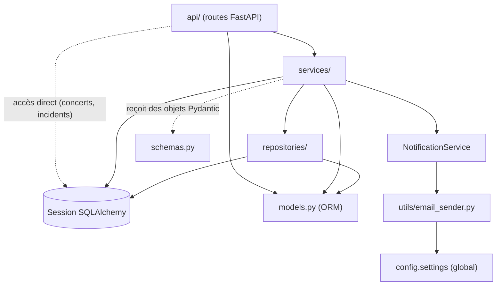

Les flèches pointent partout vers des détails techniques (ORM, session, email, config globale). Rien ne pointe vers un contrat abstrait, et les services instancient eux-mêmes leurs dépendances (`NotificationService()`, `ConcertRepository(db)`).

### 4.3 Où sont les règles métier

| Règle | Où elle est vérifiée aujourd'hui | Problème |
|---|---|---|
| R1 fin > début | Route `reschedule_concert`, `create_concert` et `reschedule_concert` du service | Copiée 3 fois pour les concerts (plus une pour les dates du festival), sans objet métier qui la porte |
| R2, R3 chevauchements | `SchedulingService._check_conflicts`, appelée uniquement par `create_concert` | **Absente au déplacement** (défaut 1) |
| R4 existence et scène du festival | `create_concert` | Seulement à la création |
| R5 équipements | `create_concert` | Absente au déplacement |
| R6 concert dans le festival | `create_concert` | Absente au déplacement |
| R7 planning publié non modifiable | Nulle part | Défaut 3 |
| R8 publication sous conditions | Nulle part | `publish` change simplement le statut |
| R9 capacité > 0 | Pydantic (`StageCreate`, `gt=0`) | Protégée uniquement à l'entrée HTTP, pas dans le métier |
| R10 incident | Pydantic (`min_length=3`) et vérification d'existence dans la route | `"   "` est accepté, et la règle n'existe pas hors HTTP |

### 4.4 Dépendances directes à FastAPI et SQLAlchemy

- **FastAPI** : `main.py` et tous les fichiers de `api/` (`APIRouter`, `Depends`, `HTTPException`). Ce sont bien des adaptateurs, mais ils contiennent de la logique métier.
- **SQLAlchemy** : `database.py`, `models.py`, `repositories/`, **tous les services** (paramètre `Session`, `db.query`, `commit`) et même deux routes (`api/concerts.py`, `api/incidents.py`).
- **Pydantic** : les services lisent `payload.start_time`, `payload.artist_id`… sur des schémas HTTP, ce qui lie le cœur applicatif au format de la requête.
- **Config globale** : `email_sender.py` lit `settings.fail_notifications`, impossible à remplacer sans modifier l'objet global.

### 4.5 Problèmes de testabilité

- Aucune règle métier ne peut être testée sans base : tout passe par `TestClient` et SQLite.
- `conftest.py` doit fixer `FESTIPLAN_DATABASE_URL` avant d'importer l'application, car l'engine est créé à l'import.
- La notification n'est pas injectable : pour simuler une panne, il faut modifier `settings` en global.
- Impossible de tester le cas d'usage « déplacer un concert » avec un faux repository.

### 4.6 Risques d'incohérence

- Chaque `repo.create` fait son propre `commit` : il n'existe aucune frontière de transaction pour un cas d'usage.
- `commit` puis notification dans le même flux : l'échec d'envoi se transforme en HTTP 500 alors que les données sont enregistrées (défaut 2).
- `Festival.status` et `Concert.status` sont des chaînes libres, sans transitions contrôlées (défaut 3). `cancel_concert` peut aussi annuler un concert d'un planning publié.
- La publication existe en double (`FestivalService.publish` et `PublicationService.publish`) avec des comportements différents : l'un notifie, l'autre non.
- La vérification des conflits lit puis écrit sans protection, donc deux requêtes simultanées peuvent toutes deux passer.

### 4.7 Exemple concret de responsabilité mal placée

`api/concerts.py`, route `reschedule_concert` : le contrôleur HTTP interroge directement la base (`db.query(Concert)`), vérifie lui-même que le concert existe, revérifie `end_time > start_time`, puis appelle `SchedulingService.reschedule_concert`, qui refait ces vérifications avant de modifier le concert. Le même contrôleur traduit aussi les erreurs de service (`ValueError` → 400, `RuntimeError` → 500).

Conséquences :
- la règle R1 est copiée à plusieurs endroits, et la règle de conflit (R2, R3) n'est pas appliquée à cet endroit, alors qu'elle existe pour la création ;
- le contrôleur ne peut pas être remplacé (CLI, test, autre API) sans perdre une partie des règles ;
- une `RuntimeError` venant de la notification est interprétée comme une erreur du cas d'usage, d'où le 500 du défaut 2.

### 4.8 Conclusion

Les défauts 1 et 3 viennent de règles absentes ou éparpillées, et le défaut 2 de l'absence de frontière entre l'opération métier et ses effets de bord. La refactorisation vise à regrouper les règles dans un domaine indépendant, à faire dépendre les cas d'usage de ports abstraits, et à reléguer FastAPI, SQLAlchemy et l'envoi de notifications au rang d'adaptateurs.

## 5. Modélisation du domaine (DDD)

### 5.1 Entités

Une entité a une identité qui reste pertinente pendant tout son cycle de vie.

| Entité | Identité | Rôle |
|---|---|---|
| `Festival` | `FestivalId` | Événement global. Porte sa période et l'état du planning (`PREPARATION` / `PUBLISHED`) |
| `Stage` | `StageId` | Scène d'un festival. Porte sa capacité et ses équipements |
| `Artist` | `ArtistId` | Artiste programmable. Porte ses besoins techniques |
| `Concert` | `ConcertId` | Représentation d'un artiste sur une scène pendant un créneau. Statut `scheduled` / `cancelled` |
| `Incident` | `IncidentId` | Fait signalé, rattaché à un concert |

Deux concerts avec les mêmes horaires restent deux concerts distincts : c'est leur identifiant qui les distingue.

### 5.2 Objets-valeurs

Immuables, vérifiés à la création : on ne peut pas construire un objet invalide.

| Objet-valeur | Invariant | Règle |
|---|---|---|
| `TimeSlot(start, end)` | `end > start` strictement. Méthode `overlaps(other)` | R1, R2, R3 |
| `FestivalPeriod(start, end)` | `end > start`. Méthode `contains(slot)` | R6 |
| `EquipmentSet` | Ensemble d'équipements normalisés. Méthode `covers(other)` | R5 |
| `Capacity` | Strictement positive | R9 |

### 5.3 Agrégats et justification

Option retenue : **un agrégat par racine, avec un service de domaine pour les règles qui concernent plusieurs concerts**.

- **`Concert`** est l'agrégat de la programmation. Il se déplace (`reschedule(new_slot)`) et s'annule, et il produit des événements.
- **`Festival`** est un agrégat séparé qui porte l'état du planning et ses transitions (`publish`, `unpublish`, `ensure_editable`).
- **`Stage`, `Artist`, `Incident`** sont des agrégats séparés, référencés par identifiant.
- **`SchedulingPolicy`** est un service de domaine. Il reçoit le festival, la scène, l'artiste et les autres concerts, et vérifie R2 à R7 une seule fois, pour la création comme pour le déplacement.

**Pourquoi pas `Festival` comme racine contenant tous ses concerts ?** Cela garantirait mieux les invariants entre concerts, mais obligerait à charger et à sauvegarder tout le planning à chaque déplacement. Pour ce projet, un service de domaine est plus simple et suffit.

**Compromis assumé :** `Concert` ne peut pas garantir seul R2 et R3, car elles dépendent d'autres concerts. La cohérence est alors protégée par le cas d'usage, qui appelle systématiquement `SchedulingPolicy`.

### 5.4 Où chaque invariant est garanti

| Règle | Garantie par | Mécanisme |
|---|---|---|
| R1 | `TimeSlot` | Exception à la construction |
| R2, R3 | `SchedulingPolicy` | Comparaison avec les concerts actifs de la scène et de l'artiste |
| R4 | Cas d'usage et `SchedulingPolicy` | Existence via les repositories, puis scène du bon festival |
| R5 | `SchedulingPolicy` avec `EquipmentSet` | Les équipements de l'artiste sont couverts par la scène |
| R6 | `SchedulingPolicy` avec `FestivalPeriod` | Le créneau est contenu dans la période |
| R7 | `Festival.ensure_editable()` | Refus si le planning est publié |
| R8 | `SchedulingPolicy.validate_planning`, appelée par le cas d'usage de publication | Revalidation de tous les concerts actifs avant `Festival.publish()` |
| R9 | `Capacity` | Exception à la construction |
| R10 | `Incident` | Description non vide après nettoyage des espaces, concert existant |

Pydantic reste limité à la forme de la requête HTTP : types, longueurs, champs obligatoires.

### 5.5 États du planning

```
PREPARATION --publish()--> PUBLISHED
PUBLISHED  --unpublish()--> PREPARATION
```

| Opération | `PREPARATION` | `PUBLISHED` |
|---|---|---|
| Programmer un concert | autorisé | refusé (409) |
| Déplacer un concert | autorisé | refusé (409) |
| Annuler un concert | autorisé | refusé (409) |
| Publier | autorisé si R8 respectée | refusé (déjà publié) |
| Dépublier | refusé (non publié) | autorisé |
| Déclarer un incident | autorisé | autorisé |

### 5.6 Commande, cas d'utilisation, événement, mécanisme technique

Pour « déplacer un concert » :

| Notion | Élément |
|---|---|
| Commande (la demande) | `RescheduleConcert(concert_id, new_start, new_end)` |
| Cas d'utilisation (l'orchestration) | `RescheduleConcertUseCase` : charge, vérifie, déplace, enregistre |
| Événement (le fait accompli) | `ConcertRescheduled` |
| Mécanisme technique (la réaction) | Port `NotificationPort`, implémenté par un adaptateur d'envoi d'email |

Événements prévus : `ConcertRescheduled`, `ConcertCancelled`, `PlanningPublished`.

### 5.7 Décisions pour les défauts

**Défaut 3 (planning publié).** Les opérations de programmation sont **refusées avec HTTP 409** tant que le planning est publié. La procédure explicite est `POST /festivals/{id}/unpublish` : on repasse en préparation, on modifie, puis on republie. Choisi pour sa simplicité, sa testabilité et sa clarté métier.

**Défaut 2 (notification).** Le cas d'usage enregistre la modification (**commit**), puis publie les événements. Si l'envoi de la notification échoue, l'erreur est **journalisée et ignorée** : l'API répond 200, car l'opération métier a réussi. Compromis : la notification perdue n'est pas rejouée (pas d'outbox ni de file de relance). Cette limite sera indiquée dans la note d'architecture.

**Erreurs de domaine envisagées :** `InvalidTimeSlot`, `StageSlotConflict`, `ArtistSlotConflict`, `MissingEquipment`, `OutsideFestivalPeriod`, `PlanningLocked`, `NotFound`. L'adaptateur HTTP les traduit (400, 404, 409).

## 6. Architecture réalisée

### 6.1 Organisation du code

```
app/
  domain/                      cœur métier, Python pur
    value_objects.py             TimeSlot, FestivalPeriod, EquipmentSet, Capacity
    entities.py                  Festival, Concert, Stage, Artist, Incident
    policies.py                  SchedulingPolicy (R2 à R7, validation R8)
    events.py                    ConcertRescheduled, ConcertCancelled, PlanningPublished
    errors.py                    erreurs métier
  application/                 cas d'usage et ports
    ports.py                     repositories et NotificationPort (contrats)
    schedule_concert.py, reschedule_concert.py, cancel_concert.py,
    planning.py, incidents.py, catalog.py, queries.py
    event_dispatch.py            envoi des événements après enregistrement
    errors.py                    EntityNotFound, ReferenceNotFound
  adapters/
    inbound/http/              adaptateur entrant FastAPI
      routeurs, schemas.py (Pydantic), presenters.py, errors.py
    outbound/persistence/      adaptateur sortant SQLAlchemy
      sql_repositories.py, models.py (ORM), database.py
    outbound/notification/     adaptateur sortant de notification
      email_notifier.py, email_sender.py
  composition.py               assemblage des dépendances
  main.py, config.py, seed.py
```

**Règle de dépendance :** `domain` n'importe rien d'autre que lui-même, `application` n'importe que `domain`, et les adaptateurs importent `application` et `domain`. Seuls `composition.py` et `main.py` connaissent à la fois les cas d'usage et les technologies. La vérification est faite par une recherche d'imports de `fastapi`, `sqlalchemy` et `pydantic` dans `domain/` et `application/` : aucun résultat.

### 6.2 Diagramme de composants

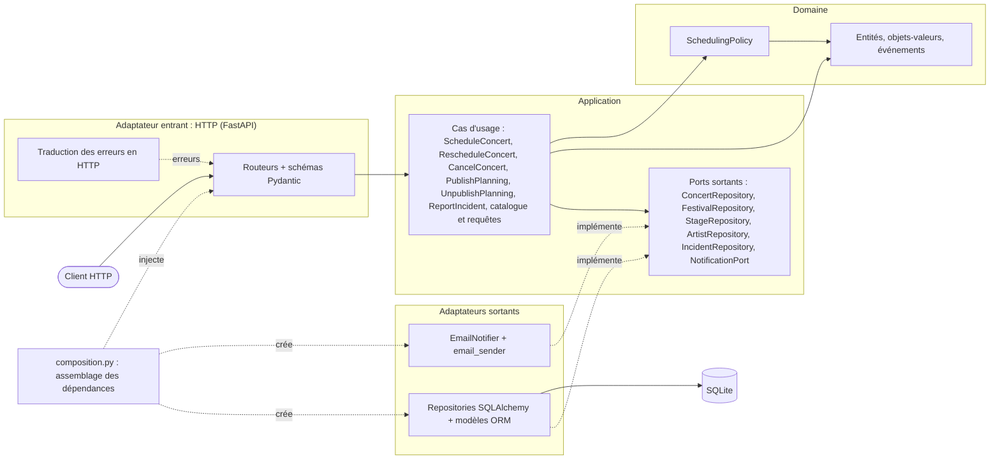

Source UML (PlantUML) : `docs/diagrams/components.puml`.

### 6.3 Diagramme de séquence : déplacer un concert

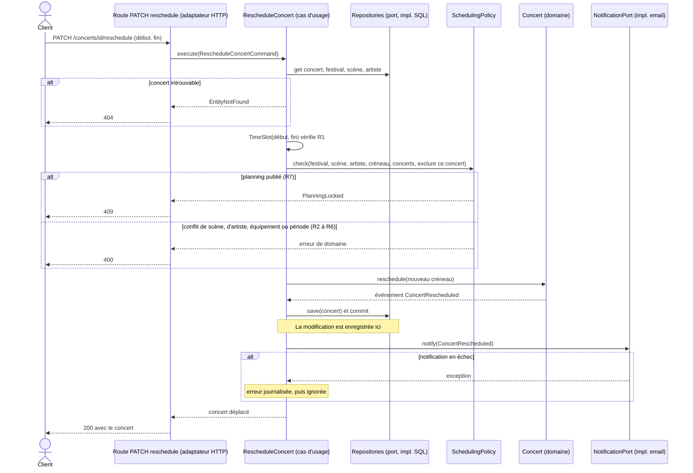

Le point important : la réponse 200 est décidée **après** l'enregistrement. L'échec de la notification est capturé dans `dispatch_events` et ne peut plus transformer une opération réussie en erreur 500.

Source UML (PlantUML) : `docs/diagrams/sequence-reschedule.puml`.

## 7. Note d'architecture

### 7.1 Défauts de l'architecture initiale
Détaillés en section 4. En résumé : aucune couche domaine, des règles métier absentes ou copiées à plusieurs endroits (le conflit n'était vérifié qu'à la création), des services couplés à `Session` SQLAlchemy et à l'envoi d'email, des contrôleurs qui accédaient à la base, et un statut de planning sans transitions contrôlées.

### 7.2 Responsabilités par couche

| Couche | Responsabilité | Ne doit pas |
|---|---|---|
| Domaine | Représenter les concepts métier et garantir les invariants (R1 à R10) | connaître HTTP, SQL, email |
| Application | Orchestrer un cas d'usage : charger, appeler le domaine, enregistrer, déclencher les effets de bord | contenir des règles métier ni importer un framework |
| Adaptateurs entrants | Traduire HTTP en commandes et résultats en réponses | décider d'une règle métier |
| Adaptateurs sortants | Implémenter les ports avec une technologie (SQLAlchemy, email) | être appelés directement par le domaine |
| Composition | Créer les implémentations et les injecter | contenir de la logique |

### 7.3 Ports et adaptateurs

| Port (application) | Adaptateur | Utilité |
|---|---|---|
| `ConcertRepository`, `FestivalRepository`, `StageRepository`, `ArtistRepository`, `IncidentRepository` | `Sql*Repository` | Les cas d'usage dépendent d'un contrat. SQLAlchemy peut être remplacé, et les tests utilisent des repositories en mémoire |
| `NotificationPort` | `EmailNotifier` | Le cas d'usage ignore le moyen d'envoi. Les tests utilisent un notifier qui enregistre ou qui échoue |
| (entrant) cas d'usage | Routeurs FastAPI | Un contrôleur adapte une requête à un cas d'usage, il ne contient plus de règle |

### 7.4 Modèle de domaine
Voir la section 5. Choix principaux : objets-valeurs (`TimeSlot`, `FestivalPeriod`, `EquipmentSet`, `Capacity`) qui rendent R1 et R9 impossibles à violer, `Festival` qui porte les transitions du planning, `Concert` comme agrégat de la programmation, et un service de domaine `SchedulingPolicy` qui centralise R2 à R7 pour tous les cas d'usage.

### 7.5 Correction des trois défauts

| Défaut | Correction | Preuve |
|---|---|---|
| 1. Chevauchements | Le déplacement appelle `SchedulingPolicy.check`, la même que la programmation, avec le concert exclu de la comparaison. Les conflits de scène et d'artiste sont refusés avec 400 | `test_reschedule_overlapping_same_stage_is_rejected`, `test_reschedule_same_artist_on_two_stages_is_rejected`, `test_scheduling_policy.py`, `test_reschedule_concert.py` |
| 2. Notification | L'enregistrement précède l'envoi. L'échec est journalisé et ignoré par `dispatch_events`, donc l'API répond 200 et la modification reste valide | `test_reschedule_succeeds_even_if_notification_fails`, `test_notification_failure_does_not_fail_the_reschedule`, `test_publish_succeeds_even_if_notification_fails` |
| 3. Planning publié | `Festival` porte un état (`PREPARATION` ou `PUBLISHED`). Programmer, déplacer et annuler sont refusés avec **409** quand il est publié. La procédure explicite est `POST /festivals/{id}/unpublish`, puis modification, puis nouvelle publication | `test_reschedule_after_publication_is_rejected`, `test_published_planning_lifecycle`, `test_entities.py` |

La publication applique aussi R8 : elle revalide tous les concerts actifs avant de passer à `PUBLISHED`.

### 7.6 Stratégie de tests
Voir le tableau de la section 3. Principe : les règles métier sont testées sans framework ni base (97 tests), les cas d'usage avec des doubles en mémoire, et seule une couche plus fine passe par HTTP et SQLite. Les 5 tests de non-régression ont été écrits avant la correction et échouaient sur le legacy (4 échecs sur 5, voir la section 3).

### 7.7 Changements de comportement par rapport au legacy

| Sujet | Avant | Maintenant |
|---|---|---|
| Notification en échec | HTTP 500 après enregistrement | HTTP 200, échec journalisé |
| Publication | Aucun contrôle, statut modifié, notification propagée | R8 vérifiée, 409 si déjà publié |
| Annulation | Possible à tout moment, aucune notification | Refusée si publié (409), notifie `ConcertCancelled` |
| Concert annulé | Pouvait être déplacé | 409 |
| Création d'un concert avec une référence inconnue | 400 | 400 (conservé) |
| Dépublication | N'existait pas | `POST /festivals/{id}/unpublish` |
| Description d'incident `"   "` | Acceptée | 400 (R10) |

### 7.8 Limites restantes et compromis
- **Pas d'unité de travail.** Chaque repository fait son propre `commit`. Pour les cas d'usage actuels, une seule écriture a lieu avant les événements, donc c'est suffisant. Un cas d'usage qui écrirait plusieurs agrégats pourrait laisser un état partiel.
- **Concurrence.** Vérifier les conflits puis écrire n'est pas atomique : deux requêtes simultanées peuvent toutes deux passer. Une contrainte en base ou un verrou serait nécessaire en production.
- **Notification non rejouée.** Si l'envoi échoue, l'événement est perdu (journalisé seulement). Une file de relance ou un « outbox » serait la suite logique. C'est le compromis choisi pour rester proportionné.
- **Choix « Concert agrégat + service de domaine ».** Les invariants entre concerts (R2, R3) et le statut du planning ne sont pas garantis par `Concert` seul : ils reposent sur le fait que chaque cas d'usage appelle `SchedulingPolicy.check`. Un nouveau cas d'usage qui l'oublierait contournerait la règle. Le choix `Festival` racine contenant ses concerts l'éviterait, au prix d'un chargement plus lourd.
- **Schéma de base conservé.** Les équipements restent stockés en texte séparé par des virgules, les statuts en chaînes. La conversion est faite dans l'adaptateur. Il n'y a pas de migration : le dossier `migrations` référencé par `alembic.ini` n'existe pas dans le dépôt initial.
- **Configuration globale.** `email_sender` lit toujours `settings.fail_notifications`. C'est acceptable pour un faux expéditeur, et les tests modifient cet objet avec `monkeypatch`.
- **Données incohérentes en base.** Si une ligne référence une scène ou un artiste absent (impossible via l'API), la publication échouerait sur une erreur technique.
- **Doublons d'artistes.** Le nom est unique en base. Un doublon provoque toujours une erreur de contrainte (comportement du legacy conservé, non traité).
- **Pydantic.** Il reste limité à la forme des requêtes (types, longueurs), les règles métier sont dans le domaine.
